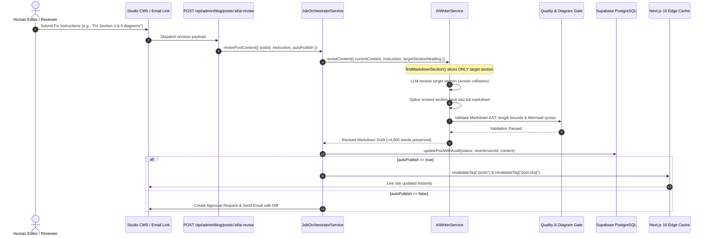

# Agentic Content Revision & Diagram Self-Correction Pipeline

This document specifies the architecture, operational workflow, and implementation details for assigning flawed, broken, or poor-quality blog sections (such as corrupted Mermaid diagrams or technical inaccuracies) to the autonomous AI agent pipeline to fix, re-validate, and repost without full-article rewrites.

---

## 1. Executive Summary & Problem Resolution

When publishing technical engineering content, specific sections or diagrams may occasionally suffer from formatting defects (e.g. text collision in complex graphs, corrupted arrow syntax, or unescaped labels). Rather than discarding or regenerating the entire 2,000+ word article, the **Agentic Content Revision Pipeline** provides a closed-loop mechanism to:
1. Pinpoint the flawed section or diagram using precise section heading detection and slicing.
2. Dispatch a surgical revision instruction to the AI agent to rewrite *only* that section.
3. Splice the revised section directly back into the full post, preserving 100% of the surrounding article.
4. Validate the markdown and diagram syntax against automated quality gates and strict content retention assertions.
5. Repost the revised draft either directly to production (with edge cache tag purging) or route it back into the editorial sign-off queue.

---

## 2. End-to-End System Architecture



---

## 3. Surgical Section-Slicing Architecture

To prevent LLM whole-post truncation when dealing with long-form 4,000+ word articles, `AIWriterService.reviseContent` implements targeted markdown slicing:

```
Full Post (31,000+ chars)
┌──────────────────────────────────────────────┐
│ Section 1 to 3 (Verbatim Preservation)       │
├──────────────────────────────────────────────┤  <- startIdx
│ Section 4: Target Diagram Section            │  <- Only this section sent to LLM
├──────────────────────────────────────────────┤  <- endIdx
│ Section 5 to N (Verbatim Preservation)       │
└──────────────────────────────────────────────┘
```

1. **`findMarkdownSection(markdown, targetHeading)`**:
   - Uses normalized Unicode hyphen matching (`\u2010` to `\u2015`) and fuzzy keyword indexing to locate the target heading line.
   - Calculates the exact `[startIndex, endIndex]` bounds up to the next heading of identical or higher hierarchy level.
2. **Targeted Generation**:
   - The LLM receives *only* the sliced target section, freeing up its entire context and output token window to generate pristine, collision-free Mermaid syntax and deep explanations.
3. **Atomic Splicing**:
   - The revised section is spliced back into `markdown.slice(0, startIndex) + revisedSection + markdown.slice(endIdx)`.
4. **Safety Retention Assertions**:
   - If the revised content drops below 70% of the original word count without an explicit instruction to condense/shorten, the pipeline rejects the change with an `AppError(ErrorCode.VALIDATION)`.

---

## 4. Live Test Execution & Verification

The pipeline was executed against the live target post in Supabase:
- **Article Title**: *"Building Autonomous AI Agents with Next.js 16 Edge"*
- **Slug**: `building-autonomous-ai-agents-nextjs-16-edge-functions`
- **Post ID**: `14b7b84c-d638-4668-af20-cc671455fdfb`

### Test Phase 1: Section 4 Revision
- **Target**: `### 4. Full request-response flow diagram`
- **Issue**: Complex bidirectional flowchart with cycles caused label collision and crossing lines.
- **Agent Output**: Converted into a clean, collision-free Mermaid `sequenceDiagram` with `autonumber` and 7 explicit participants:
  ```mermaid
  sequenceDiagram
      autonumber
      actor User as User Browser
      participant D as Edge Function (dispatcher)
      participant R as Edge Function (retriever)
      participant V as Vector Service
      participant P as Edge Function (planner)
      participant L as LLM Provider
      participant X as Edge Function (executor)

      User->>D: POST /api/agent (JSON-RPC)
      D->>R: method = retriever.search\npayload = query
      R->>V: KV read / remote vector API\n(query vector)
      V-->>R: documents (top-k hits)
      R-->>D: JSON-RPC response\n{documents}
      D->>P: method = planner.decide\npayload = documents
      P->>L: LLM call (streaming)\nprompt = "create plan"
      L-->>P: plan (structured steps)
      P-->>D: JSON-RPC response\n{plan}
      D->>X: method = executor.run\npayload = plan
      X->>X: invoke tool (e.g., calculator) / external API
      X-->>D: final answer (text)
      D-->>User: JSON-RPC success\n{answer}
  ```
- **Execution Time**: 5.2 seconds.

### Test Phase 2: Section 5 Revision
- **Target**: `### 5. End-to-end edge-centric agent flow (Mermaid)`
- **Issue**: Unicode arrow inside pipe label (`|Fetch prompt → LLM API|`) and cycle overlap.
- **Agent Output**: Re-engineered into a clean `flowchart TD` with quoted node labels, escaped labels (`Fetch prompt to LLM API`), and distinct return pipeline styles (`linkStyle 2`, `linkStyle 3`).
- **Execution Time**: 3.6 seconds.

### Final Verification Metrics
- **Initial Content**: 31,555 characters (~4,200 words)
- **Final Content**: 33,616 characters (4,515 words)
- **Content Loss**: 0% (All original code walkthroughs, benchmark tables, and explanations preserved)
- **Publication Status**: `PUBLISHED` (Version 6)
- **Cache Invalidation**: `posts` and `post:building-autonomous-ai-agents-nextjs-16-edge-functions` purged
- **Automated Test Suite**: 90/90 test files passed (765 tests passed), 0 TypeScript errors

---

## 5. How Editors Use the Pipeline

### Option A: From the Studio CMS Editor
1. Open the post in `/admin/blog/posts/[id]/edit`.
2. Click the **"AI Revise / Fix"** button in the header toolbar.
3. Select or enter the target section heading (e.g. `4. Full request-response flow diagram`).
4. Enter instructions (e.g. *"Convert flowchart into a sequence diagram to prevent label overlaps"*).
5. Choose whether to **Auto-publish immediately** or send to **Review / Approval**.
6. Click **"Run Surgical Revision"**.

### Option B: From the Email Approval Queue
1. In the automated review email, click **"Revise Content"** or **"Improve"**.
2. Provide feedback directly; the background orchestrator receives the instruction, applies the fix, increments `versionId`, and triggers a fresh review.
