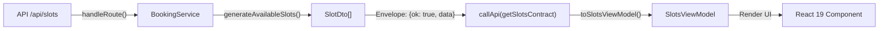

# Frontend Integration Guide: `GET /api/slots`

This document details the complete end-to-end integration specifications for the **Consultation & Booking Slots API** (`GET /api/slots`) within the Techsonance Infotech web platform.

---

## 1. Endpoint Overview & Purpose

| Property | Value |
| :--- | :--- |
| **Route** | `GET /api/slots` |
| **Handler** | [`app/api/slots/route.ts`](file:///c:/Users/manis/DEVELOPMENT-CODES-AND-PROJECTS/techsonance-infotech-website-2026/app/api/slots/route.ts) |
| **Contract** | [`lib/contracts/booking.contract.ts`](file:///c:/Users/manis/DEVELOPMENT-CODES-AND-PROJECTS/techsonance-infotech-website-2026/lib/contracts/booking.contract.ts) |
| **Service** | [`lib/services/booking.service.ts`](file:///c:/Users/manis/DEVELOPMENT-CODES-AND-PROJECTS/techsonance-infotech-website-2026/lib/services/booking.service.ts) |
| **Client Fetcher** | [`lib/api/callApi.ts`](file:///c:/Users/manis/DEVELOPMENT-CODES-AND-PROJECTS/techsonance-infotech-website-2026/lib/api/callApi.ts) |
| **ViewModel** | [`features/booking/view-models.ts`](file:///c:/Users/manis/DEVELOPMENT-CODES-AND-PROJECTS/techsonance-infotech-website-2026/features/booking/view-models.ts) |
| **Authentication** | `none` (Public endpoint) |
| **Rate Limit** | 60 requests / minute per client IP |
| **HTTP Caching** | `public, s-maxage=300, stale-while-revalidate=600` |

### Core Business Purpose
- Computes valid **30-minute consultation slots** in Indian Standard Time (`Asia/Kolkata`).
- Filters out non-working business days (Sunday), official holidays, and times outside business hours (10:00 AM – 7:00 PM IST).
- Enforces an automated **12-hour minimum notice period** so same-day immediate or past slots cannot be scheduled.
- Re-used across the interactive Chatbot widget (`BookingCard`), standalone contact pages, and discovery booking modals.

---

## 2. API Contract & Wire Protocol

All responses strictly follow the project's **Discriminated Union Response Envelope**:
`{ ok: true, data: T } | { ok: false, error: ErrorPayload }`

### 2.1 Query Parameters

| Parameter | Type | Required | Default | Validation Rule / Range |
| :--- | :--- | :--- | :--- | :--- |
| `daysAhead` | `number` (integer) | No | `14` | Min: `1`, Max: `30` |
| `fromTimestamp` | `number` (epoch ms) | No | `Date.now()` | Positive integer |

### 2.2 Success Response (`200 OK`)

```json
{
  "ok": true,
  "data": {
    "timezone": "Asia/Kolkata",
    "count": 48,
    "slots": [
      {
        "id": "2026-11-09T04:30:00.000Z",
        "iso": "2026-11-09T04:30:00.000Z",
        "dateIST": "2026-11-09",
        "startIST": "10:00 AM",
        "endIST": "10:30 AM",
        "dayOfWeek": "Monday"
      },
      {
        "id": "2026-11-09T05:00:00.000Z",
        "iso": "2026-11-09T05:00:00.000Z",
        "dateIST": "2026-11-09",
        "startIST": "10:30 AM",
        "endIST": "11:00 AM",
        "dayOfWeek": "Monday"
      }
    ]
  }
}
```

### 2.3 Error Response Envelope (`4xx` / `5xx`)

```json
{
  "ok": false,
  "error": {
    "code": "VALIDATION",
    "message": "Invalid query parameters",
    "fieldErrors": {
      "daysAhead": ["Number must be less than or equal to 30"]
    },
    "requestId": "req_01j9a8b7c6d5e4f3"
  }
}
```

### 2.4 Error Codes Matrix

| HTTP Status | ErrorCode Enum | Cause / Scenario |
| :--- | :--- | :--- |
| `403` | `ErrorCode.FORBIDDEN` | Request origin header failed allowed-domain check |
| `422` | `ErrorCode.VALIDATION` | Invalid query parameters (`daysAhead > 30` or non-integer) |
| `429` | `ErrorCode.RATE_LIMITED` | Client IP exceeded 60 requests/minute (carries `retryAfterSec`) |
| `500` | `ErrorCode.INTERNAL` | Internal slot generator or server failure |
| `503` | `ErrorCode.UNAVAILABLE` | Remote network partition or database unreachable |

---

## 3. Architecture Pipeline: Server to Client

The pipeline strictly enforces layer decoupling and zero type leakage:



1. **Wire Layer**: `GET /api/slots` strictly checks origins and executes through `handleRoute`.
2. **Client Fetch Layer**: Pre-validates query options via `callApi(getSlotsContract, { query })`.
3. **ViewModel Layer**: `toSlotsViewModel(data)` converts flat slot DTOs into grouped, pre-formatted structures for instant dropdown and calendar rendering.

---

## 4. Frontend Integration Code Examples

### 4.1 Custom React Hook: `useBookingSlots`

Create or import this hook in feature components:

```tsx
"use client";

import { useState, useEffect, useCallback } from "react";
import { callApi } from "@/lib/api/callApi";
import { getSlotsContract } from "@/lib/contracts/booking.contract";
import { toSlotsViewModel, type SlotsViewModel } from "@/features/booking/view-models";

export type UseBookingSlotsOptions = {
  daysAhead?: number;
  autoFetch?: boolean;
};

export function useBookingSlots({ daysAhead = 14, autoFetch = true }: UseBookingSlotsOptions = {}) {
  const [viewModel, setViewModel] = useState<SlotsViewModel | null>(null);
  const [isLoading, setIsLoading] = useState(autoFetch);
  const [errorMessage, setErrorMessage] = useState<string | null>(null);

  const fetchSlots = useCallback(async () => {
    setIsLoading(true);
    setErrorMessage(null);

    const result = await callApi(getSlotsContract, {
      query: { daysAhead },
    });

    if (result.ok) {
      const vm = toSlotsViewModel(result.data);
      setViewModel(vm);
    } else {
      setErrorMessage(result.error.message || "Failed to load consultation slots.");
    }

    setIsLoading(false);
  }, [daysAhead]);

  useEffect(() => {
    if (autoFetch) {
      void fetchSlots();
    }
  }, [autoFetch, fetchSlots]);

  return {
    slots: viewModel?.slots ?? [],
    slotsByDate: viewModel?.slotsByDate ?? {},
    timezone: viewModel?.timezone ?? "Asia/Kolkata",
    count: viewModel?.count ?? 0,
    isEmpty: viewModel?.isEmpty ?? false,
    isLoading,
    errorMessage,
    refetch: fetchSlots,
  };
}
```

---

### 4.2 Complete UI Component with 6 Async States

In accordance with **Rule 05 (UI States, Forms & Accessibility)**, here is the production-ready component:

```tsx
"use client";

import React, { useState } from "react";
import { Calendar, Clock, AlertCircle, RefreshCw } from "lucide-react";
import { useBookingSlots } from "./useBookingSlots";

interface SlotPickerProps {
  onSelectSlot: (slotIso: string) => void;
  selectedSlotIso?: string;
}

export function SlotPicker({ onSelectSlot, selectedSlotIso }: SlotPickerProps) {
  const { slotsByDate, isLoading, errorMessage, isEmpty, refetch } = useBookingSlots();
  const [selectedDate, setSelectedDate] = useState<string>("");

  // 1. Loading State (Layout-matching skeleton)
  if (isLoading) {
    return (
      <div className="space-y-3 animate-pulse" aria-busy="true" aria-label="Loading available slots">
        <div className="h-4 w-40 bg-zinc-200 dark:bg-zinc-800 rounded" />
        <div className="h-10 w-full bg-zinc-100 dark:bg-zinc-800 rounded-lg border border-zinc-200 dark:border-zinc-700" />
      </div>
    );
  }

  // 2. Error State (With actionable retry)
  if (errorMessage) {
    return (
      <div role="alert" className="p-4 rounded-xl border border-red-200 bg-red-50 dark:bg-red-950/20 dark:border-red-900/50">
        <div className="flex items-start gap-3">
          <AlertCircle className="w-5 h-5 text-red-600 dark:text-red-400 shrink-0 mt-0.5" />
          <div className="space-y-2">
            <p className="text-sm font-medium text-red-800 dark:text-red-200">{errorMessage}</p>
            <button
              type="button"
              onClick={() => void refetch()}
              className="inline-flex items-center gap-1.5 text-xs font-semibold text-red-700 dark:text-red-300 hover:underline"
            >
              <RefreshCw className="w-3.5 h-3.5" /> Retry Loading Slots
            </button>
          </div>
        </div>
      </div>
    );
  }

  // 3. Empty State (No available slots)
  if (isEmpty || Object.keys(slotsByDate).length === 0) {
    return (
      <div className="text-center p-6 border border-zinc-200 dark:border-zinc-800 rounded-xl bg-zinc-50 dark:bg-zinc-900">
        <Calendar className="w-8 h-8 text-zinc-400 mx-auto mb-2" />
        <p className="text-sm font-medium text-zinc-700 dark:text-zinc-300">
          No consultation slots available for the next 14 days.
        </p>
        <p className="text-xs text-zinc-500 mt-1">
          Please reach out directly to <a href="mailto:info@techsonance.co.in" className="underline text-brand-500">info@techsonance.co.in</a>.
        </p>
      </div>
    );
  }

  // 4. Ready Data State
  const dateKeys = Object.keys(slotsByDate);
  const activeDate = selectedDate || dateKeys[0];
  const activeSlots = slotsByDate[activeDate] || [];

  return (
    <div className="space-y-4">
      {/* Date Select Dropdown */}
      <div>
        <label htmlFor="slot-date-select" className="block text-xs font-semibold text-zinc-700 dark:text-zinc-300 mb-1">
          Select Consultation Date (IST)
        </label>
        <select
          id="slot-date-select"
          value={activeDate}
          onChange={(e) => setSelectedDate(e.target.value)}
          className="w-full px-3 py-2 text-sm rounded-lg border border-zinc-300 dark:border-zinc-700 bg-white dark:bg-zinc-900 text-zinc-900 dark:text-zinc-100 focus:outline-hidden focus:ring-2 focus:ring-brand-500"
        >
          {dateKeys.map((dateStr) => {
            const dayName = slotsByDate[dateStr][0]?.dayOfWeek;
            return (
              <option key={dateStr} value={dateStr}>
                {dayName}, {dateStr} ({slotsByDate[dateStr].length} slots)
              </option>
            );
          })}
        </select>
      </div>

      {/* Time Slots Grid */}
      <div>
        <span className="block text-xs font-semibold text-zinc-700 dark:text-zinc-300 mb-2">
          Available 30-Minute Windows
        </span>
        <div className="grid grid-cols-2 sm:grid-cols-3 gap-2 max-h-48 overflow-y-auto p-1">
          {activeSlots.map((slot) => {
            const isSelected = selectedSlotIso === slot.iso;
            return (
              <button
                key={slot.id}
                type="button"
                onClick={() => onSelectSlot(slot.iso)}
                aria-pressed={isSelected}
                className={`flex items-center justify-center gap-1.5 px-3 py-2 text-xs font-medium rounded-lg border transition-all ${
                  isSelected
                    ? "bg-brand-600 text-white border-brand-600 shadow-xs"
                    : "bg-white dark:bg-zinc-800 border-zinc-200 dark:border-zinc-700 text-zinc-800 dark:text-zinc-200 hover:border-brand-500"
                }`}
              >
                <Clock className="w-3.5 h-3.5 opacity-70 shrink-0" />
                <span>{slot.formattedTimeRange}</span>
              </button>
            );
          })}
        </div>
      </div>
    </div>
  );
}
```

---

## 5. Verification Checklist

- [x] **Contract Validation**: Registered in [`lib/contracts/booking.contract.ts`](file:///c:/Users/manis/DEVELOPMENT-CODES-AND-PROJECTS/techsonance-infotech-website-2026/lib/contracts/booking.contract.ts) with strict Zod 4 input & response schemas.
- [x] **Route Invariants**: Wrapped with `handleRoute()` in [`app/api/slots/route.ts`](file:///c:/Users/manis/DEVELOPMENT-CODES-AND-PROJECTS/techsonance-infotech-website-2026/app/api/slots/route.ts) with origin validation and rate limiting.
- [x] **Client Fetch Abstraction**: Accessible through [`lib/api/callApi.ts`](file:///c:/Users/manis/DEVELOPMENT-CODES-AND-PROJECTS/techsonance-infotech-website-2026/lib/api/callApi.ts) with typed `Result<T>` returns.
- [x] **ViewModel Pipeline**: ViewModels and mappers defined in [`features/booking/view-models.ts`](file:///c:/Users/manis/DEVELOPMENT-CODES-AND-PROJECTS/techsonance-infotech-website-2026/features/booking/view-models.ts).
- [x] **Automated Tests**: Unit & boundary tests verified in [`tests/slots-endpoint.test.ts`](file:///c:/Users/manis/DEVELOPMENT-CODES-AND-PROJECTS/techsonance-infotech-website-2026/tests/slots-endpoint.test.ts) (7 passing tests).
- [x] **Typecheck & Build**: Verified with `npm run typecheck` and `npm run build` with 0 errors.
