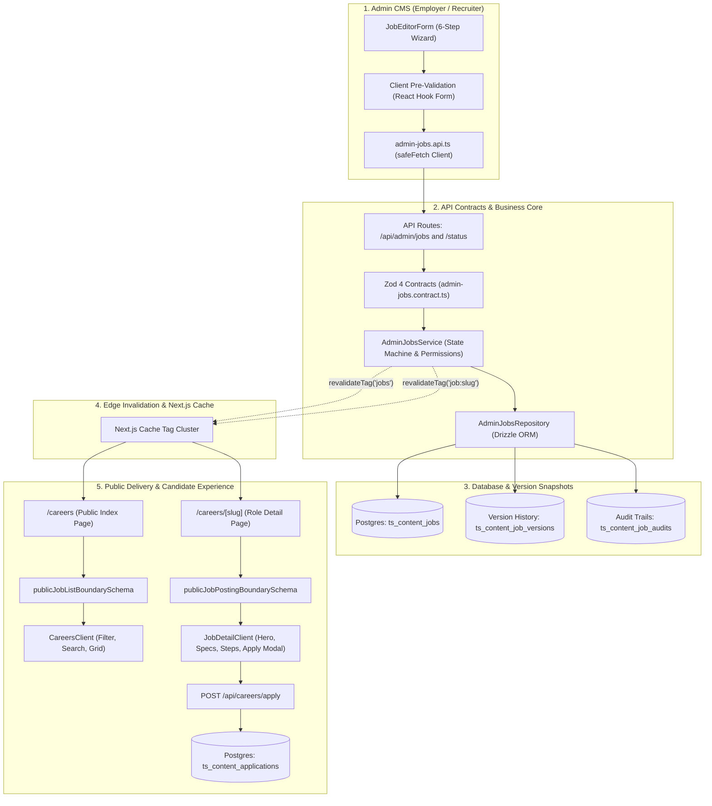
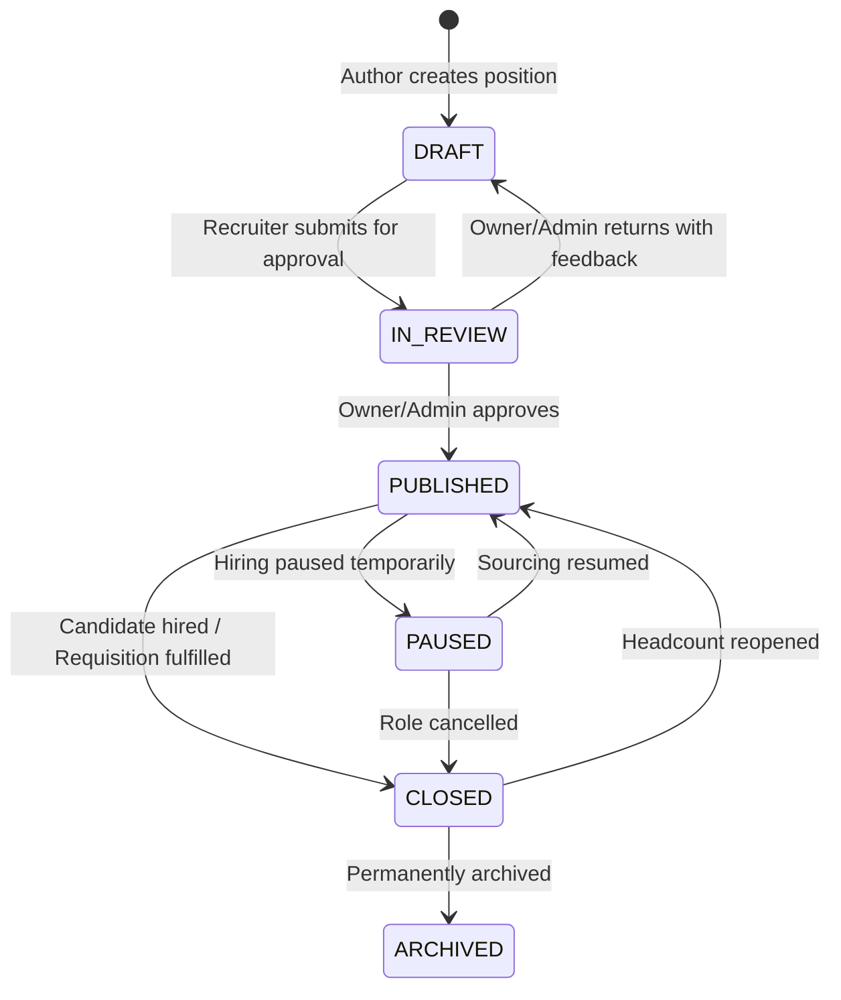
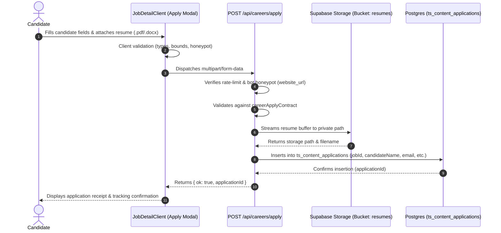

# Careers & Job Openings Architecture Audit & Flow Specification

**Project:** TechSonance Infotech LLP Website (2026 Engine)  
**System:** Recruitment, Requisition Lifecycle, Content Management & Public Careers Portal  
**Audit Scope:** End-to-End Ingestion, Database Topology, Boundary Contracts, Lifecycle State Transitions, Edge Cache Invalidation, and Public Page Rendering.

---

## 1. System Architecture Overview

The recruitment platform operates on a **contract-first, isolated 3-tier architecture**:



---

## 2. Ingestion Pipeline: Admin Form Steps to Database Mapping

The job requisition authoring wizard in `components/admin/careers/JobEditorForm.tsx` collects candidate requirements through six discrete tabs. Each form field connects to the PostgreSQL database table `ts_content_jobs` (`lib/database/schema/core/job.schema.ts`).

### Step 1: Basics (`id: "basics"`)

| Form Field Name | Input Type & Validation | DB Column (`ts_content_jobs`) | Postgres Type & Constraints | Default Value | Role & Presentation on Public Site |
| :--- | :--- | :--- | :--- | :--- | :--- |
| `title` | Text (min 3 chars, trim) | `title` | `text NOT NULL` | *None* | Role title in `<h1>` heading, search index, and metadata. |
| `slug` | Text (kebab-case, unique) | `slug` | `text NOT NULL` | *None* | Dynamic route parameter: `/careers/[slug]`. |
| `referenceCode` | Text (e.g. `ENG-2026-04`) | `reference_code` | `text` | `NULL` | Displayed as high-contrast mono badge in role hero. |
| `department` | Dropdown select | `department` | `text NOT NULL` | *None* | Filter category pill on `/careers` and navigation breadcrumb. |
| `openingsCount` | Integer (min 1) | `openings_count` | `integer NOT NULL` | `1` | Role at-a-glance sidebar metadata (`X Open Positions`). |
| `summary` | Textarea (max 500 chars) | `summary` | `text NOT NULL` | `''` | Role card preview text and fallback meta description. |

---

### Step 2: Location & Work Mode (`id: "location"`)

| Form Field Name | Input Type & Allowed Values | DB Column (`ts_content_jobs`) | Postgres Type & Constraints | Default Value | Public Visual Mapping |
| :--- | :--- | :--- | :--- | :--- | :--- |
| `location` | Text (`Bhubaneswar, India`) | `location` | `text NOT NULL` | *None* | Displayed with `MapPin` icon on job cards and role header. |
| `workMode` | Enum (`on_site`, `hybrid`, `remote`) | `work_mode` | `JobWorkModeEnum NOT NULL` | `'hybrid'` | Work arrangement badge on cards and role specs. |
| `remoteEligibility` | Text (`India / Worldwide`) | `remote_eligibility` | `text` | `NULL` | Subtext under work mode explaining geo-boundaries. |
| `visaSupport` | Enum (`yes`, `no`, `case_by_case`) | `visa_support` | `JobVisaSupportEnum` | `'no'` | Sidebar specification badge under "Visa Sponsorship". |
| `type` | Enum (`full_time`, `contract`, etc.) | `type` | `JobTypeEnum NOT NULL` | `'full_time'` | Contract nature badge (`Full Time`, `Contract`, `Internship`). |
| `experienceLevel` | Enum (`entry`, `mid`, `senior`, `lead`) | `experience_level` | `JobExperienceLevelEnum` | `'mid'` | Seniority badge on cards and role specs. |

---

### Step 3: Content, Specs & Roadmap (`id: "content"`)

| Form Field Name | Input Type & Structure | DB Column (`ts_content_jobs`) | Postgres Type & Constraints | Public Section & Visual Layout |
| :--- | :--- | :--- | :--- | :--- |
| `description` | Markdown / Rich Text | `description` | `text NOT NULL` | **"Role Overview"**: Formatted rich-text description. |
| `responsibilities` | Dynamic string array | `responsibilities` | `text[] NOT NULL` | **"Key Responsibilities"**: Checkmark bullet list. |
| `requirements` | Dynamic string array | `requirements` | `text[] NOT NULL` | **"Core Qualifications"**: Mandatory requirements list. |
| `preferredQualifications` | Dynamic string array | `preferred_qualifications` | `text[] NOT NULL` | **"Bonus Points & Nice-to-Haves"**: Secondary qualifications list. |
| `skills` | Dynamic string array | `skills` | `text[] NOT NULL` | **"Skills & Technologies"**: Interactive tech-stack chips. |
| `benefits` | Dynamic string array | `benefits` | `text[] NOT NULL` | **"Perks & Benefits"**: 2-column benefit cards. |
| `aboutTeam` | Multi-line text | `about_team` | `text` | **"About the Team"**: Culture and group mission block. |
| `hiringProcess` | Array of `{ step, title, desc }` | `hiring_process` | `jsonb` | **"Hiring Steps Journey"**: Numbered 4-step interview timeline. |
| `equalOpportunityStatement` | Long text | `equal_opportunity_statement` | `text` | **"EEOC Commitment"**: Legal diversity & inclusion block. |

---

### Step 4: Compensation (`id: "compensation"`)

| Form Field Name | Input Type | DB Column (`ts_content_jobs`) | Postgres Type | Visibility Rule & Client Presentation |
| :--- | :--- | :--- | :--- | :--- |
| `showSalaryPublicly` | Boolean toggle | `show_salary_publicly` | `boolean NOT NULL DEFAULT false` | **Gatekeeper**: If `false`, compensation is completely hidden. |
| `salaryMin` | Numeric integer | `salary_min` | `integer` | Lower bound in pay range pill (e.g. `₹18,00,000`). |
| `salaryMax` | Numeric integer | `salary_max` | `integer` | Upper bound in pay range pill (e.g. `₹28,00,000`). |
| `salaryCurrency` | String (`INR`, `USD`, `EUR`) | `salary_currency` | `text DEFAULT 'INR'` | Currency symbol and ISO prefix. |
| `salaryPeriod` | Enum (`year`, `month`, `hour`) | `salary_period` | `JobSalaryPeriodEnum DEFAULT 'year'` | Denominator tag (`/year`, `/month`, `/hour`). |
| `compensationNotes` | Textarea | `compensation_notes` | `text` | Explanatory note for equity, ESOPs, or performance bonuses. |

---

### Step 5: Application Settings (`id: "application"`)

| Form Field Name | Input Type & Structure | DB Column (`ts_content_jobs`) | Postgres Type | Candidate Interaction Pattern |
| :--- | :--- | :--- | :--- | :--- |
| `applicationMethod` | Enum (`builtin`, `external`) | `application_method` | `JobApplicationMethodEnum NOT NULL` | If `builtin`, opens in-app drawer; if `external`, opens URL in new tab. |
| `externalApplyUrl` | URL string | `external_apply_url` | `text` | Destination URL when `applicationMethod === 'external'`. |
| `resumeRequired` | Boolean toggle | `resume_required` | `boolean NOT NULL DEFAULT true` | Toggles mandatory validation on resume upload in the application form. |
| `coverLetterRequirement` | Enum (`off`, `optional`, `required`) | `cover_letter_requirement` | `JobCoverLetterRequirementEnum NOT NULL` | Controls visibility and validation of the cover letter input area. |
| `screeningQuestions` | Array of Question Objects | `screening_questions` | `jsonb NOT NULL DEFAULT '[]'` | Dynamically generated custom screening fields in the modal. |

---

### Step 6: Review, Scheduling & SEO (`id: "review"`)

| Form Field Name | Input Type | DB Column (`ts_content_jobs`) | Postgres Type | Execution & Discovery Impact |
| :--- | :--- | :--- | :--- | :--- |
| `status` | Enum (`DRAFT`, `PUBLISHED`, etc.) | `status` | `JobStatusEnum NOT NULL` | Controls lifecycle state and public availability. |
| `publishAt` | ISO Datetime | `publish_at` | `timestamptz` | Release timestamp for automated publishing schedules. |
| `closesAt` | ISO Datetime | `closes_at` | `timestamptz` | Expiration date; renders countdown indicator on client page. |
| `visibility` | Enum (`public`, `unlisted`) | `visibility` | `JobVisibilityEnum NOT NULL` | `unlisted` roles are reachable by direct link but hidden from index. |
| `featured` | Boolean toggle | `featured` | `boolean NOT NULL DEFAULT false` | Pins card to top of `/careers` with "Featured Opening" badge. |
| `seoTitle` | Text string | `seo_title` | `text` | `<title>` tag and SERP headline. |
| `seoDescription` | Text string | `seo_description` | `text` | `<meta name="description">` content. |
| `ogImage` | URL string | `og_image` | `text` | OpenGraph social preview image (`og:image`). |

---

## 3. Requisition Lifecycle State Machine & Status Invalidation



### Transition Validation Rules (`AdminJobsService.transitionStatus`)

| Source Status | Permitted Target Statuses | Required Actor Role | System Actions on Database & Cache |
| :--- | :--- | :--- | :--- |
| **`DRAFT`** | `IN_REVIEW`, `PUBLISHED` | Recruiter, Editor, Admin, Owner | Sets `approvalStatus = PENDING`. If direct publish by Admin: sets `publishedAt = now()`. |
| **`IN_REVIEW`** | `PUBLISHED`, `SCHEDULED`, `DRAFT` | Admin, Owner only | If approved: sets `publishedAt = now()`, `approvalStatus = APPROVED`. If returned: records `approvalComment`. |
| **`PUBLISHED` / `OPEN`** | `PAUSED`, `CLOSED`, `IN_REVIEW`, `DRAFT` | Recruiter, Editor, Admin, Owner | If closed: sets `closedAt = now()`. Calls `revalidateJobCache()`. |
| **`PAUSED`** | `PUBLISHED`, `CLOSED` | Recruiter, Editor, Admin, Owner | Updates status and invalidates Next.js cache tags. |
| **`CLOSED`** | `PUBLISHED`, `DRAFT`, `ARCHIVED` | Admin, Owner only | If reopened to published: resets `closedAt = null` and invalidates tags. |

### Edge Cache Invalidation Flow
When a status change occurs in `AdminJobsService`:
1. `revalidateTag("jobs", "default")`: Purges cached `/careers` listing arrays.
2. `revalidateTag("job:${slug}", "default")`: Purges cached HTML/RSC payloads for `/careers/[slug]`.
3. Client navigations immediately receive updated state on subsequent requests.

---

## 4. Public Rendering & Live Page Section Mapping

### A. Careers Index Page (`/careers`)
File: `app/careers/page.tsx` & `app/careers/CareersClient.tsx`

1. **Server Fetching**: Calls `getJobSource().list({ status: JobStatus.PUBLISHED })`.
2. **Boundary Validation**: Parsed with `publicJobListBoundarySchema` (corrupted items caught safely without white-screening).
3. **Filter Engine**: `filterJobs()` filters by:
   - Department (`department`)
   - Work Mode (`workMode`)
   - Experience Level (`experienceLevel`)
   - Keyword search across `title`, `summary`, and `skills`.
4. **Display Rule**:
   - `PUBLISHED` / `OPEN` positions are displayed in the active openings grid.
   - `CLOSED`, `PAUSED`, and `DRAFT` positions are completely excluded.

---

### B. Role Detail Page (`/careers/[slug]`)
File: `app/careers/[slug]/page.tsx` & `app/careers/[slug]/JobDetailClient.tsx`

```
┌────────────────────────────────────────────────────────────────────────┐
│  BREADCRUMB: Home > Careers > [department] > [title]                   │
├────────────────────────────────────────────────────────────────────────┤
│  STATUS BANNER: If status === CLOSED or PAUSED                         │
│  -> <ClosedJobBanner /> renders notice + suggests similar roles        │
├────────────────────────────────────────────────────────────────────────┤
│  HERO SECTION:                                                         │
│  - Title (H1): [title]                                                 │
│  - Reference Code: [referenceCode] (Mono badge)                        │
│  - Badges: [department], [location] + [workMode], [type], [expLevel]  │
│  - Salary Pill: [salaryMin] - [salaryMax] (if showSalaryPublicly=true) │
│  - CTA: [ Apply Now ] (Disabled if CLOSED or PAUSED)                   │
├────────────────────────────────────────────────────────────────────────┤
│  LEFT COLUMN (70%):                 │  RIGHT COLUMN (30%):             │
│  1. Role Overview                   │  1. Role At a Glance             │
│     -> [description] (Markdown)     │     -> Openings: [openingsCount] │
│  2. Key Responsibilities            │     -> Closes: [closesAt]        │
│     -> [responsibilities]           │     -> Visa: [visaSupport]       │
│  3. Core Qualifications             │  2. About the Team               │
│     -> [requirements]               │     -> [aboutTeam]               │
│  4. Preferred Qualifications        │  3. Hiring Process Journey       │
│     -> [preferredQualifications]    │     -> [hiringProcess] (Roadmap) │
│  5. Skills & Tech Stack             │  4. Recommended Openings         │
│     -> [skills] (Pill chips)        │     -> [similarJobs]             │
│  6. Perks & Benefits                │                                  │
│     -> [benefits] (Card grid)       │                                  │
│  7. Equal Opportunity Statement     │                                  │
│     -> [equalOpportunityStatement]  │                                  │
└────────────────────────────────────────────────────────────────────────┘
```

---

## 5. Candidate Application Ingestion Pipeline

When a candidate applies on `/careers/[slug]`:



### Application Database Schema (`ts_content_applications`)

| Column Name | Postgres Type & Constraints | Purpose |
| :--- | :--- | :--- |
| `id` | `uuid PRIMARY KEY DEFAULT gen_random_uuid()` | Unique application tracking ID. |
| `site_id` | `uuid NOT NULL REFERENCES ts_content_sites` | Multi-tenant tenant boundary. |
| `job_id` | `uuid NOT NULL REFERENCES ts_content_jobs` | Foreign key linking applicant to requisition. |
| `job_version_id` | `integer NOT NULL DEFAULT 1` | Snapshot version of job when applicant applied. |
| `candidate_name` | `text NOT NULL` | Candidate legal full name. |
| `email` | `text NOT NULL` | Primary communication channel. |
| `phone` | `text` | Contact phone number. |
| `current_location` | `text` | Current city/region. |
| `portfolio_url` | `text` | Personal site / portfolio link. |
| `github_url` | `text` | Developer profile. |
| `linkedin_url` | `text` | Professional social profile. |
| `resume_storage_path` | `text NOT NULL` | Path inside private Supabase storage bucket. |
| `resume_file_name` | `text NOT NULL` | Original filename uploaded by user. |
| `cover_letter` | `text` | Candidate pitch. |
| `notice_period_weeks` | `integer` | Candidate availability timeline. |
| `screening_answers` | `jsonb NOT NULL DEFAULT '[]'` | Answers to custom screening questions. |
| `knockout_triggered` | `boolean NOT NULL DEFAULT false` | Automatically flagged if knockout answer chosen. |
| `status` | `ApplicationStatusEnum DEFAULT 'NEW'` | Pipeline status: `NEW`, `SCREENING`, `INTERVIEW`, `OFFER`, `HIRED`. |
| `privacy_consent_date` | `timestamptz NOT NULL DEFAULT now()` | GDPR/privacy consent compliance stamp. |

---

## 6. Audit Verdict & Architecture Compliance

1. **Isolation & Security**: Requisition and application tables carry strict multi-tenant constraints and foreign key cascade rules. No bare updates or deletes are permitted.
2. **Boundary Resilience**: Corrupted or null fields in old records degrade safely to fallback defaults via `.catch()` transforms in `publicJobPostingBoundarySchema`, preventing client-side application crashes.
3. **State Reflection**: Status changes trigger deterministic edge cache invalidation (`jobs` and `job:slug`), ensuring public pages reflect hiring closures immediately.
