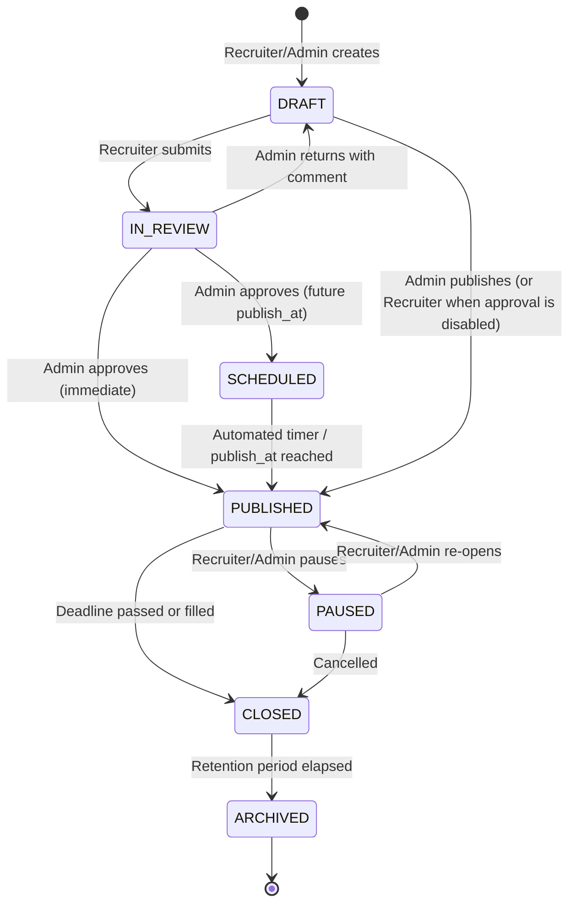

# Agency Careers Page & CMS Admin – Production Specification

**Date:** 2026-11-05  
**Author:** TechSonance Engineering & AI Assistant  
**Source Document:** [`Agency Careers Page and CMS Admin Production-Ready Project Doc.md`](file:///c:/Users/manis/Downloads/Agency%20Careers%20Page%20and%20CMS%20Admin%20Production-Ready%20Project%20Doc.md)  
**Status:** Approved for Implementation Planning  

---

## 1. Executive Summary & Production Objectives

This specification defines the production-ready implementation of the TechSonance Careers Module and CMS Admin. It upgrades the existing lightweight prototype into an enterprise-grade recruitment and applicant tracking sub-system.

### Primary Objectives

1. **Self-Service Recruiter Workflow:** Non-technical hiring coordinators can author, preview, request approval, schedule, update, pause, and close roles in minutes without developer assistance.
2. **High-Performance Public Portal:** Fast, responsive public careers experience (WCAG 2.2 AA compliant, mobile-optimized, cache-backed with instant revalidation on status changes).
3. **Dedicated Role Addresses (`/careers/[slug]`):** Permanent, SEO-optimized canonical addresses with rich Schema.org `JobPosting` JSON-LD, social share cards, and graceful closed-role banners that never 404.
4. **Reliable Application Intake:** End-to-end data integrity—applications are saved to `ts_content_applications`, resumes are stored in private Supabase Storage with signed-url downloads, duplicate applications are detected, and dual transactional emails are dispatched in the background.
5. **Applicant Pipeline & Privacy (GDPR/EEOC):** 8-stage candidate review pipeline with internal notes and ratings, knockout question alerting, talent-pool retention consent, and GDPR-compliant candidate data deletion.

---

## 2. System Architecture & Data Flow

```
                                      +---------------------------------------------+
                                      |           Supabase Database / Storage       |
                                      |  - ts_content_jobs (extended schema)        |
                                      |  - ts_content_applications (linked version) |
                                      |  - ts_content_talent_pool                   |
                                      |  - ts_content_eeoc_responses (isolated)     |
                                      |  - ts_content_careers_settings              |
                                      |  - Storage bucket: "resumes" (private)      |
                                      +----------------------+----------------------+
                                                             |
                                  Drizzle ORM (Transaction)  |  Private Signed URLs
                                                             |
                               +-----------------------------v-------------------------------+
                               |                   Next.js 16 App Router                     |
                               |                                                             |
[Recruiters / Admins] ---------> app/admin/careers/                                          |
                               |   ├── jobs/                     (Table, Search, Status tab) |
                               |   ├── jobs/[id]/                (Multi-section Job Editor,  |
                               |   │                              Checklist, Live Preview,   |
                               |   │                              Version History)           |
                               |   ├── applications/             (8-Stage Pipeline, Kanban / |
                               |   │                              Table, Candidate Drawer,   |
                               |   │                              Notes, Ratings, CSV Export)|
                               |   └── settings/                 (Approval Toggle, Retention)|
                               |                                                             |
                               | lib/services/                                               |
                               |   ├── admin-jobs.service.ts     (Job CRUD, Status Lifecycle)|
                               |   ├── career-apply.service.ts   (Intake, Resume validation) |
                               |   ├── applications.service.ts   (Pipeline, Notes, Ratings)  |
                               |   └── email.service.ts          (Dual Background Alerting)  |
                               |                                                             |
[Public Candidates] -----------> app/careers/                                                |
                               |   ├── page.tsx & CareersClient  (Search, Facets, URL sync,  |
                               |   │                              Talent Pool capture CTA)   |
                               |   ├── [slug]/page.tsx           (Detail Page, Sticky Apply, |
                               |   │                              JobPosting JSON-LD, Banner)|
                               |   └── sitemap.ts                (Dynamic open jobs indexing)|
                               +-------------------------------------------------------------+
```

---

## 3. Database Schema & Migration Strategy

Existing tables [`ts_content_jobs`](file:///c:/Users/manis/DEVELOPMENT-CODES-AND-PROJECTS/techsonance-infotech-website-2026/lib/database/schema/core/job.schema.ts) and [`ts_content_applications`](file:///c:/Users/manis/DEVELOPMENT-CODES-AND-PROJECTS/techsonance-infotech-website-2026/lib/database/schema/core/application.schema.ts) will be extended using a versioned, reversible Drizzle migration. New companion tables for settings, talent pool, and EEOC isolation are introduced.

### 3.1 Extended `ts_content_jobs` Schema

```typescript
// Extended fields in lib/database/schema/core/job.schema.ts
export const jobsTable = pgTable(
  "ts_content_jobs",
  {
    ...baseEntityFields, // id, createdAt, updatedAt
    siteId: uuid("site_id").notNull().references(() => sitesTable.id, { onDelete: "cascade" }),
    slug: text("slug").notNull(),
    title: text("title").notNull(),
    referenceCode: text("reference_code"), // e.g. "ENG-2026-04"
    department: text("department").notNull(),
    openingsCount: integer("openings_count").notNull().default(1),
    ownerId: uuid("owner_id").references(() => usersTable.id), // Recruiter responsible
    hiringManagerId: uuid("hiring_manager_id").references(() => usersTable.id), // Read-only reviewer
    summary: text("summary").notNull(), // Short snippet for cards and meta description

    // Work Mode & Strict Single-Location Rule
    workMode: text("work_mode").notNull().default("hybrid"), // 'on_site' | 'hybrid' | 'remote'
    location: text("location").notNull(), // e.g. "Bhubaneswar, India" or "Remote"
    remoteEligibility: text("remote_eligibility"), // e.g. "India, APAC, or Worldwide"
    visaSupport: text("visa_support").default("no"), // 'yes' | 'no' | 'case_by_case'

    // Engagement & Content
    type: text("type").notNull().default("full_time"), // 'full_time' | 'part_time' | 'contract' | 'internship' | 'freelance' | 'temporary'
    experienceLevel: text("experience_level").default("mid"), // 'entry' | 'mid' | 'senior' | 'lead' | 'executive'
    description: text("description").notNull(), // Rich text / markdown
    responsibilities: text("responsibilities").array().notNull().default([]),
    requirements: text("requirements").array().notNull().default([]),
    preferredQualifications: text("preferred_qualifications").array().notNull().default([]),
    skills: text("skills").array().notNull().default([]),
    benefits: text("benefits").array().notNull().default([]),
    aboutTeam: text("about_team"),
    hiringProcess: jsonb("hiring_process").default([]), // [{ step: "01", title: "...", desc: "..." }]
    equalOpportunityStatement: text("equal_opportunity_statement"),

    // Compensation
    salaryMin: integer("salary_min"),
    salaryMax: integer("salary_max"),
    salaryCurrency: text("salary_currency").default("INR"),
    salaryPeriod: text("salary_period").default("year"), // 'hour' | 'month' | 'year'
    showSalaryPublicly: boolean("show_salary_publicly").notNull().default(false),
    compensationNotes: text("compensation_notes"), // Equity, performance bonus

    // Application Configuration
    applicationMethod: text("application_method").notNull().default("builtin"), // 'builtin' | 'external'
    externalApplyUrl: text("external_apply_url"),
    resumeRequired: boolean("resume_required").notNull().default(true),
    coverLetterRequirement: text("cover_letter_requirement").notNull().default("optional"), // 'off' | 'optional' | 'required'
    screeningQuestions: jsonb("screening_questions").notNull().default([]),
    // [{ id: string, question: string, type: 'short_text'|'long_text'|'boolean'|'choice', options?: string[], required: boolean, knockoutAnswer?: string|boolean }]

    // Publishing, Status & Scheduling
    status: text("status").notNull().default("DRAFT"), // 'DRAFT' | 'IN_REVIEW' | 'SCHEDULED' | 'PUBLISHED' | 'PAUSED' | 'CLOSED' | 'ARCHIVED'
    approvalStatus: text("approval_status").default("pending"), // 'pending' | 'approved' | 'returned'
    approvalComment: text("approval_comment"),
    publishAt: timestamp("publish_at", { withTimezone: true }),
    closesAt: timestamp("closes_at", { withTimezone: true }),
    visibility: text("visibility").notNull().default("public"), // 'public' | 'unlisted'
    featured: boolean("featured").notNull().default(false),

    // SEO & Social
    seoTitle: text("seo_title"),
    seoDescription: text("seo_description"),
    ogImage: text("og_image"),

    // Telemetry & Versioning
    versionId: integer("version_id").notNull().default(1),
    viewCount: integer("view_count").notNull().default(0),
    applyCount: integer("apply_count").notNull().default(0),
    publishedAt: timestamp("published_at", { withTimezone: true }),
    closedAt: timestamp("closed_at", { withTimezone: true }),
  },
  (table) => [
    uniqueIndex("ts_content_jobs_site_slug_idx").on(table.siteId, table.slug),
    index("ts_content_jobs_status_idx").on(table.status),
    index("ts_content_jobs_dept_idx").on(table.department),
  ]
);
```

### 3.2 Extended `ts_content_applications` Schema

```typescript
export const applicationsTable = pgTable(
  "ts_content_applications",
  {
    ...baseEntityFields,
    siteId: uuid("site_id").notNull().references(() => sitesTable.id, { onDelete: "cascade" }),
    jobId: uuid("job_id").notNull().references(() => jobsTable.id, { onDelete: "cascade" }),
    jobVersionId: integer("job_version_id").notNull().default(1), // Snapshot version applied to
    candidateName: text("candidate_name").notNull(),
    email: text("email").notNull(),
    phone: text("phone"),
    currentLocation: text("current_location"),
    portfolioUrl: text("portfolio_url"),
    githubUrl: text("github_url"),
    linkedinUrl: text("linkedin_url"),
    resumeStoragePath: text("resume_storage_path").notNull(), // Private path in Supabase bucket
    resumeFileName: text("resume_file_name").notNull(),
    resumeMimeType: text("resume_mime_type").notNull(),
    coverLetter: text("cover_letter"),
    noticePeriodWeeks: integer("notice_period_weeks"),

    // Screening Answers & Knockout detection
    screeningAnswers: jsonb("screening_answers").notNull().default([]),
    // [{ questionId: string, question: string, answer: any, isKnockout: boolean }]
    knockoutTriggered: boolean("knockout_triggered").notNull().default(false),

    // Source tracking
    source: text("source").default("direct"), // 'direct' | 'linkedin' | 'referral' | etc.

    // Pipeline & Internal Review
    status: text("status").notNull().default("NEW"),
    // 'NEW' | 'SCREENING' | 'SHORTLISTED' | 'INTERVIEW' | 'OFFER' | 'HIRED' | 'REJECTED' | 'WITHDRAWN'
    rejectionReason: text("rejection_reason"),
    internalNotes: text("internal_notes"),
    rating: integer("rating"), // 1 to 5 stars

    // Compliance & Consent
    privacyConsentDate: timestamp("privacy_consent_date", { withTimezone: true }).notNull().defaultNow(),
    privacyNoticeVersion: text("privacy_notice_version").notNull().default("2026-v1"),
    talentPoolConsent: boolean("talent_pool_consent").notNull().default(false),
  },
  (table) => [
    index("ts_content_app_job_email_idx").on(table.jobId, table.email),
    index("ts_content_app_status_idx").on(table.status),
  ]
);
```

### 3.3 Companion Tables

1. **`ts_content_talent_pool`**: Candidates captured from the empty-state form or candidates who consented to stay in the talent pool after job closure.
   - Fields: `id`, `siteId`, `name`, `email`, `phone`, `skills` (`text[]`), `preferredRole`, `experienceLevel`, `portfolioUrl`, `resumeStoragePath`, `notes`, `consentDate`, `createdAt`.
2. **`ts_content_eeoc_responses`**: Stored in a separate table with NO link to candidate profile to satisfy legal diversity requirements without biasing hiring decisions.
   - Fields: `id`, `jobId`, `gender`, `ethnicity`, `veteranStatus`, `disabilityStatus`, `createdAt`.
3. **`ts_content_careers_settings`**: Global agency configuration.
   - Fields: `id`, `siteId`, `requireApprovalToPublish` (boolean, default: true), `defaultCloseDurationDays` (integer, default: 30), `documentRetentionDays` (integer, default: 90), `adminAlertRecipients` (`text[]`).

---

## 4. Role Status Lifecycle & Workflow Engine

The 7 statuses and allowed transitions are strictly enforced in `lib/services/admin-jobs.service.ts`:



### Permission Rules
- **Recruiter:** Can create/edit `DRAFT`, submit to `IN_REVIEW`, `PAUSE` and `CLOSE` own roles. Cannot publish directly if `requireApprovalToPublish` is active.
- **Admin/Owner:** Can approve/return roles in `IN_REVIEW`, bypass approval, publish, schedule, reassign role owners, alter settings, and permanently delete data.
- **Hiring Manager:** Read-only access to assigned roles; can view applicants, submit internal notes, and assign ratings.

---

## 5. Public Careers Experience

### 5.1 Dynamic Route: `app/careers/[slug]/page.tsx`
- **Cache Strategy:** Statically rendered using `getJobSource().get(slug)` with cache tag `job:${slug}`.
- **Immediate Revalidation:** When an admin edits, publishes, pauses, or closes a role, `revalidateTag("jobs")` and `revalidateTag("job:${slug}")` are invoked.
- **Role States on Detail Page:**
  - `PUBLISHED`: Displays full job details, compensation (if toggled), and interactive Apply CTA (sticky on mobile).
  - `PAUSED`: Displays banner: *"This opening is temporarily on hold and not accepting applications."* Apply button is disabled.
  - `CLOSED`: Permanent URL retained (zero 404s). Displays banner: *"This opening is now closed and no longer accepting applications."* Form is hidden, but similar active roles in the same department are recommended.
  - `DRAFT` / `IN_REVIEW` / `UNLISTED`: Returns standard 404 unless accessed via a signed preview token.
- **SEO & Schema.org:** Generates JSON-LD `JobPosting`:
  ```json
  {
    "@context": "https://schema.org",
    "@type": "JobPosting",
    "title": "Full Stack Developer",
    "description": "...",
    "datePosted": "2026-11-05T00:00:00.000Z",
    "validThrough": "2026-12-05T23:59:59.000Z",
    "employmentType": "FULL_TIME",
    "hiringOrganization": {
      "@type": "Organization",
      "name": "TechSonance Infotech",
      "sameAs": "https://techsonance.co.in"
    },
    "jobLocationType": "TELECOMMUTE",
    "applicantLocationRequirements": {
      "@type": "Country",
      "name": "India"
    },
    "baseSalary": {
      "@type": "MonetaryAmount",
      "currency": "INR",
      "value": {
        "@type": "QuantitativeValue",
        "minValue": 1200000,
        "maxValue": 1800000,
        "unitText": "YEAR"
      }
    }
  }
  ```

### 5.2 Upgraded Listing: `app/careers/page.tsx` & `CareersClient.tsx`
- Real-time client-side search with debouncing across `title`, `summary`, and `skills`.
- Facet chips: Department, Work Mode (`Remote`, `Hybrid`, `On-site`), Employment Type, Experience Level.
- State synced bi-directionally to URL search parameters (`?dept=Engineering&mode=remote`).
- Empty State: When no roles match, renders a warm "No open roles matching your criteria" state with a one-click "Reset Filters" button and a **"Join our Talent Pool"** capture form.

### 5.3 Dynamic Sitemap: `app/sitemap.ts`
- Queries `jobsTable` for all `status = 'PUBLISHED'` and `visibility = 'public'`.
- Includes `/careers/${job.slug}` with `lastModified = job.updatedAt`.
- Automatically excludes closed, paused, or unlisted roles.

---

## 6. Application Intake, Resume Storage & Background Notifications

### 6.1 Private Resume Storage
- Resumes are validated on the server:
  - Allowed types: `application/pdf`, `application/vnd.openxmlformats-officedocument.wordprocessingml.document` (DOCX).
  - Maximum size: 5 MB.
  - File signature / magic-byte verification to avoid disguised executables.
- Uploaded directly to private Supabase Storage bucket `resumes` under the path:
  `${siteId}/${jobId}/${crypto.randomUUID()}-${sanitizedFileName}`.
- Candidates and public visitors **never** receive raw public links. Admin recruiters access resumes through short-lived signed download URLs (5-minute expiry).

### 6.2 Application Submission Flow & Edge Cases
1. **Closing Race Condition:** The server verifies `job.status === 'PUBLISHED'` and `now() <= job.closesAt`. If closed while the applicant was typing, the submission fails with a helpful error, and the candidate's input is preserved.
2. **Duplicate Prevention:** Checks `ts_content_applications` for an existing entry matching `(jobId, candidateEmail)`. If found, returns: *"You have already submitted an application for this role."*
3. **Knockout Screening:** If a candidate answers a knockout question incorrectly, the application is accepted but flagged with `knockoutTriggered = true` so recruiters can filter appropriately (no automated cold rejections without human review).
4. **Dual Email Notification:** Dispatches two emails via `EmailService`:
   - To Candidate: Branded confirmation email detailing application receipt and what to expect next.
   - To Recruiter / Role Owner: Instant notification email with candidate summary and direct link to the candidate's review profile in the CMS.

---

## 7. Admin CMS Experience

### 7.1 Rich Job Editor (`/admin/careers/jobs/[id]`)
- Grouped into 6 logical sections:
  1. **Basics:** Title, reference code, department, openings, role owner, hiring manager, summary.
  2. **Location & Mode:** Work mode, single office location or Remote, remote eligibility, visa support.
  3. **Content:** Role description, responsibilities list, qualifications, skills tags, benefits, hiring process steps.
  4. **Compensation:** Salary range, currency, pay period, and public visibility toggle.
  5. **Application Settings:** Method (builtin/external), resume requirement, cover letter policy, custom screening questions.
  6. **Publishing & Visibility:** Schedule date, deadline, visibility, featured toggle, SEO title/description.
- **Completeness Checklist:** Sticky sidebar tracks required fields and prevents submitting for review until all prerequisites are met.
- **Live Preview:** Instant toggle between Desktop and Mobile preview widths mimicking the public `/careers/[slug]` layout.

### 7.2 Applications Inbox (`/admin/careers/applications`)
- Filterable by Role, Stage, Date Range, and Knockout Status.
- Toggle between **Table View** and **Kanban Board** (8 columns: `New` → `Screening` → `Shortlisted` → `Interview` → `Offer` → `Hired` → `Rejected` → `Withdrawn`).
- **Candidate Profile Drawer:**
  - Personal info, portfolio, and LinkedIn links.
  - Inline resume previewer / download via signed URL.
  - Answers to role-specific screening questions.
  - Internal interview notes and 1-to-5 star rating.
  - Stage movement dropdown (creates audit log event).
  - Rejection modal: Prompts for rejection reason from managed list + optional candidate email.
- **Talent Pool View:** Tab for candidates who joined via general interest or opted-in after job closure.
- **GDPR / Privacy Actions:** Admin button to export all candidate data in JSON/CSV and permanently purge all candidate records across all roles on request.

---

## 8. Rollout Plan & Implementation Phases

| Phase | Milestone | Deliverables | Verification Exit Gate |
| :--- | :--- | :--- | :--- |
| **Phase 1** | Foundation & Data Model | Drizzle migration for `jobsTable`, `applicationsTable`, companion tables. `AdminJobsService` status state machine. | Migration applies cleanly; status transition unit tests pass. |
| **Phase 2** | Public Careers Portal | `/careers` search/filters/empty talent pool. Dedicated `/careers/[slug]` detail page with closed role handling, sticky CTA, and Schema.org `JobPosting` JSON-LD. Dynamic `sitemap.ts`. | Lighthouse SEO/accessibility = 100%; Google Rich Results Test passes. |
| **Phase 3** | Application Intake & ATS | Private resume Supabase storage, submission API with duplicate & knockout checks, candidate confirmation + recruiter alert emails, `/admin/careers/applications` inbox with Kanban & candidate drawer. | Successful test application submission with resume stored, candidate notified, and profile reviewable in CMS. |
| **Phase 4** | Job Editor & Admin CMS | Multi-section Job Editor with completeness checklist, live preview, approval workflow (Submit -> Approve/Return), and GDPR candidate purge tool. | Recruiter creates draft -> submits -> Admin approves -> publishes immediately to public site. |

---

## 9. Definition of Done & Quality Standards

- [ ] All database changes execute through versioned, reversible Drizzle migrations.
- [ ] No `process.env` accessed outside `lib/env`.
- [ ] All server actions and API routes enforce strict server-side authorization.
- [ ] Meets WCAG 2.2 AA accessibility (proper label associations, keyboard navigation, contrast).
- [ ] Resumes stored privately; no publicly accessible URLs exposed.
- [ ] `npm run check` (typecheck, lint, formatting, boundaries) passes with zero errors.
- [ ] `npm run build` succeeds cleanly.
